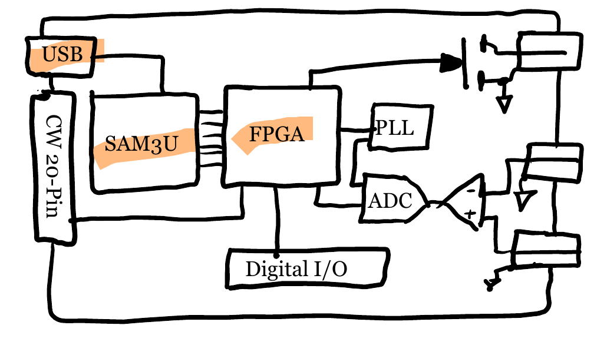

# Register Interface

In order to make almost any changes to the Husky FPGA code, one needs to
know how its register interface works. It is through this register interface
that all communication with the host PC takes place.

In this high-level diagram, the relevant blocks are highlighted in orange:



## External Interface
In the FPGA source code, most of the register interface modules and signals
have "usb" in their names because the interface originates on the USB
interface. The SAM3U processor bridges this to the FPGA via its Static
Memory Controller (SMC) interface and provides the following signals to the
FPGA:

| Signal Name | Type and Width    | Description |
|-------------|-------------------|-------------|
|`USB_Data`   | `inout wire [7:0]`| 8-bit data  |
|`USB_Addr`   | `input wire [7:0]`| 8-bit address|
|`USB_RDn`    | `input wire`      | read        |
|`USB_WRn`    | `input wire`      | write       |
|`USB_CEn`    | `input wire`      | enable      |
|`USB_ALEn`   | `input wire`      | address latch enable|
|`USB_SPARE0` | `inout wire`      | used for streaming|

We don't go into much detail for this SAM3U - FPGA interface since it is not
expected to be modified. If you wish to understand it in greater detail,
have a look at:
* the SAM3U datasheet
* our [SAM3U firmware](https://github.com/newaetech/chipwhisperer-husky)
* our [`cocotb` model](https://github.com/newaetech/chipwhisperer-husky-fpga/tree/develop/fpga/sim/husky_registers.py)
  which drives this interface in simulation


## Internal Interface
[`usb_reg_main.v`](https://github.com/newaetech/chipwhisperer-husky-fpga/tree/develop/fpga/hdl/usb_reg_main.v)
is the Husky module which bridges that interface to the simpler protocol
that is used internally; this is what you'll interact with as a developer.

The signalling for that internal register interface is as follows:

| Signal Name    | Type and Width    | Description |
|----------------|-------------------|-------------|
|`reg_read`      | wire              | read pulse  |
|`reg_write`     | wire              | write pulse |
|`write_data`    | wire [7:0]        | write data (from host to FPGA)|
|`read_data`     | wire [7:0]        | read data (from FPGA to host)|
|`reg_address`   | wire [7:0]        | address     |
|`reg_bytecnt`   | wire [6:0]        | register byte count|

The `reg_bytecnt` "register byte count" is somewhat unusual and is our way
of handling the small 8-bit width of the address and data buses.

In Husky, an 8-bit address does not refer to a single data byte of register
configuration space: it refers to anywhere from 1 to $2^7 = 128$ bytes.

How does this work? Each "register" (in the hardware configuration sense of
the word, e.g. what you would find listed in a datasheet) has an address.
This is the 8-bit address that the SAM3U provides on `USB_Addr` and which is
replicated without modifications on the internal `reg_address` bus. All
register addresses are defined in the [`registers.v`](https://github.com/newaetech/chipwhisperer-husky-fpga/tree/develop/fpga/hdl/registers.v) file[^1].

If the host wishes to read (or write) a single register byte, `reg_bytecnt`
remains 0. But if the host wishes to read (or write) more bytes for a given
register, it simply extends the read or write command. `usb_reg_main.v` then
increments `reg_bytecnt` for each successive byte.

This means that the register implementation should look like this:

```verilog
reg [23:0] config_reg;
always @(posedge clk) begin
    if (reg_write && reg_address == `CONFIG_ADDR) begin
        case (reg_bytecnt):
            0: config_reg[7:0] <= write_data;
            1: config_reg[15:8] <= write_data;
            2: config_reg[23:16] <= write_data;
        endcase
        // or, more succinctly (and less prone to typos!):
        config_reg[reg_bytecnt*8 +: 8] <= write_data;
    end

    if (reg_read && reg_address == `CONFIG_ADDR) begin
        case (reg_bytecnt):
            0: read_data <= config_reg[7:0];
            1: read_data <= config_reg[15:8];
            2: read_data <= config_reg[23:16];
        endcase
        // or, more succinctly (and less prone to typos!):
        read_data <= config_reg[reg_bytecnt*8 +: 8];
    end

end
```

You will find code like this for every configuration register in Husky.

### Timing Diagrams
Here we show timing diagrams for multi-byte writes and reads to the
`config_reg` of the example Verilog code above:

```{figure} ../Images/reg_write.png
:width: 100%
:align: center
Register writes. [(wavedrom source)](reg_write.json)
```

```{figure} ../Images/reg_read.png
:width: 100%
:align: center
Register reads. [(wavedrom source)](reg_read.json)
```

You can observe the interface timing in [simulation](../Testing/simulation)
(which uses a behavioural model of the SAM3U that is *not* cycle-accurate).

If you really want to see the actual interface timing, you can implement a
custom bitfile with an ILA to capture all interface signals. You can also
use `scope.userio` with a customized bitfile that routes the signals of
interest to the USERIO header.


### Byte Count Width
The width of `reg_bytecnt` can be anything we want (in practice this may be
limited by what the SAM3U can support), however since this signal fans out
to many, many modules within Husky, we've made it no wider than it needs to
be.


## Addressing Verilog Registers from Python
What's really neat about this register interface is that it makes it
extremely easy to work with variable-sized registers from the host Python side.

To write a single-byte register:

```python
scope.fpga_reg_write('REGISTER_ADDRESS', [0xAA])
```

To write an 8-byte register:
```python
scope.fpga_reg_write('REGISTER_ADDRESS', range(8))
```

The mechanism is similar for reads, with `scope.fpga_reg_read()`.

In the ChipWhisperer Python API code you'll find tons of these calls. They
look a bit different from what's shown above, for reasons; look for
`oa.sendMessage()` calls, with a self-explanatory `CODE_WRITE` or
`CODE_READ` argument.

You'll notice that the register address is provided as a string, not a
number. Indeed, the ChipWhisperer Python API code parses the Verilog
`registers.v` file to learn the defined address of each register, which
allows Verilog registers to be addressed by name rather than by number
(goodbye magic numbers!). This makes it very to see exactly what touches a
particular register in the Python code base. Here's an example of finding
all the code that reads or writes the `USERIO_CONFIG` register:

```
$ cd chipwhisperer/software/chipwhisperer
$ rg USERIO_CONFIG -tpy

capture/scopes/cwhardware/ChipWhispererHuskyMisc.py
988:            self._config_cache = self.oa.sendMessage(CODE_READ, "USERIO_CONFIG", maxResp=7)
993:        self.oa.sendMessage(CODE_WRITE, "USERIO_CONFIG", value)
997:        """ Convenience function for setting the registers that got merged into USERIO_CONFIG.
999:        raw = self.oa.sendMessage(CODE_READ, "USERIO_CONFIG", maxResp=7)
1013:        self.oa.sendMessage(CODE_WRITE, "USERIO_CONFIG", raw)
1018:        """ Convenience function for reading the registers that got merged into USERIO_CONFIG.
1023:            raw = self.oa.sendMessage(CODE_READ, "USERIO_CONFIG", maxResp=7)
1169:        #raw = self.oa.sendMessage(CODE_READ, "USERIO_CONFIG", maxResp=5)
1210:            raw = self.oa.sendMessage(CODE_READ, "USERIO_CONFIG", maxResp=7)
```


## Special Cases
There are two special cases that haven't been covered: fast FIFO reads, and
streaming reads.

### Fast FIFO Reads
In the "fast FIFO read" mode, the SAM3U's SMC timing is modified to execute
long reads faster, with fewer idle cycles between successive `reg_read`
pulses. Both the SAM3U and the FPGA must be told to be in "fast FIFO read"
mode. On the FPGA side, the read data must be made available *ahead* of the
`reg_read` pulse. The only way this can work is if the read address is known
and fixed, and so this only works for reading the `ADCREAD_ADDR` register
(to obtain the ADC FIFO data). Reading any other register can result in
undefined behaviour; the Python API can detect and warn the user about this.
The FPGA exits the fast FIFO read mode when it receives a write.


### Streaming Reads
The register interface also operates differently when streaming.

(More details to be added later.)


## Register Address Space
As mentioned above the address bus is 8 bits wide.
Because [TraceWhisperer](https://github.com/newaetech/tracewhisperer) began
life before Husky and exists on several platforms, it has its own
register map, defined independently from the rest of the Husky registers in
[these](https://github.com/newaetech/tracewhisperer/blob/master/hdl/defines_trace.v) 
[two](https://github.com/newaetech/tracewhisperer/blob/master/hdl/defines_pw.v)
files.

To keep things simple, the most significant address bit is used to select
the Husky address space (`reg_address[7] = 1'b0`) or the TraceWhisperer
address space (`reg_address[7] = 1'b1`).

Non-trace registers must be added on the Husky side. At the end of
[`registers.v`](https://github.com/newaetech/chipwhisperer-husky-fpga/tree/develop/fpga/hdl/registers.v)
there is a list of unused addresses.

### Reserved Address Block
(More details to be added later.)


[^1]: There is an exception for `scope.trace` aka TraceWhisperer registers,
    only because these live in a submodule.

